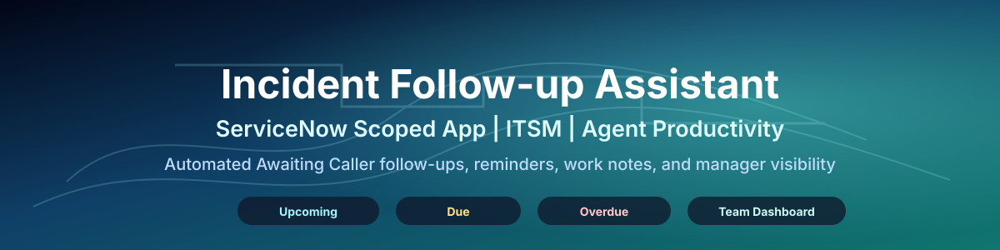
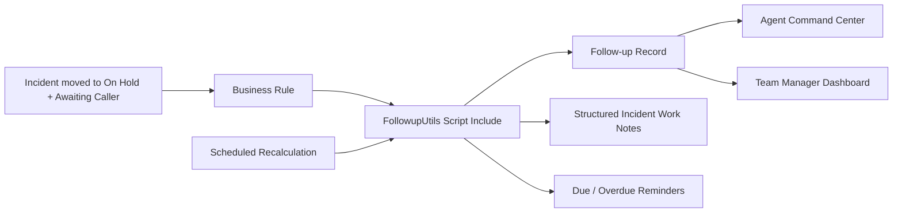

<p align="center">
  
</p>

<p align="center">
  
  
  
  
</p>

## Overview

Incident Follow-up Assistant is a ServiceNow scoped application concept for improving follow-up discipline on incidents moved to **On Hold + Awaiting Caller**. It creates a structured follow-up trail, classifies each follow-up as **Upcoming**, **Due**, or **Overdue**, helps agents update follow-ups inline, and gives team managers a dashboard for ageing, attempts, outcomes, and repeat pending cycles.

This repository is intentionally portfolio-safe. It contains reusable architecture, representative scripts, UI scaffolding, and documentation without exposing private instance URLs, client names, employee data, internal screenshots, or proprietary source exports.

## Problem

When incidents wait on caller response, follow-up ownership can become manual and inconsistent:

- agents must remember when to chase users
- work notes can be inconsistent
- managers have limited visibility into ageing and repeat pending cycles
- overdue customer follow-ups can be missed until SLA or escalation pressure appears

## Solution

The app adds a governed follow-up process around the incident lifecycle:

- detect incidents moved to **On Hold + Awaiting Caller**
- automatically create or reactivate a follow-up record
- classify follow-ups as **Upcoming**, **Due**, or **Overdue**
- allow inline updates from an Agent Command Center
- write structured Incident work notes
- send due and overdue reminders
- provide a Team Manager dashboard
- track ageing, attempts, outcomes, and repeat pending cycles
- support light and dark dashboard themes

## Repository Map

```text
.
├── README.md
├── LICENSE
├── CHANGELOG.md
├── docs/
│   ├── architecture.md
│   ├── business-process.md
│   ├── data-model.md
│   ├── deployment-guide.md
│   ├── demo-guide.md
│   ├── roadmap.md
│   └── security-model.md
├── src/
│   ├── script-includes/
│   │   └── FollowupUtils.js
│   ├── business-rules/
│   │   ├── incident-followup-manager-insert.js
│   │   ├── incident-followup-manager-update.js
│   │   ├── process-followup-attempt.js
│   │   ├── recalc-followup-status.js
│   │   └── validate-followup-attempt.js
│   ├── scheduled-jobs/
│   │   └── recalculate-followup-statuses.js
│   ├── client/
│   │   ├── agent-command-center/
│   │   │   └── AgentCommandCenter.md
│   │   └── team-overview/
│   │       ├── TeamApp.tsx
│   │       ├── TeamApp.css
│   │       ├── team-service.ts
│   │       └── components/
│   │           └── FollowupCard.tsx
│   └── configuration/
│       ├── properties.md
│       ├── roles.md
│       └── tables.md
└── screenshots/
    └── README.md
```

## Architecture



## Main Objects

| Object | Purpose |
| --- | --- |
| Incident | Source ticket being monitored while waiting on caller input |
| Follow-up record | Tracks status, due date, attempts, outcome, ageing, and repeat cycle count |
| Follow-up attempt | Optional child/audit record for each outreach attempt |
| Agent Command Center | Inline work surface for agents to update pending follow-ups |
| Team Manager dashboard | Operational view across teams, owners, due buckets, and repeat pending patterns |

## Status Buckets

| Bucket | Meaning |
| --- | --- |
| Upcoming | Follow-up exists but is not due yet |
| Due | Follow-up due date is today or inside the configured due window |
| Overdue | Follow-up due date has passed and needs attention |

## Privacy

This repository avoids:

- real client or employer names
- ServiceNow instance IDs or URLs
- employee, requester, caller, or customer records
- production screenshots
- credentials, tokens, sys_ids, or internal table names beyond generic examples
- exported update sets that may contain environment-specific metadata

## Getting Started

Use this repository as a blueprint for a ServiceNow scoped app:

1. Create a scoped app in ServiceNow Studio.
2. Define the tables and properties from `src/configuration/`.
3. Add the Script Include and Business Rules from `src/`.
4. Add the scheduled recalculation job.
5. Build the Agent Command Center and Team Overview UI from `src/client/`.
6. Validate with the demo flow in `docs/demo-guide.md`.

## Important Note

The code in this repository is a sanitized reference implementation. Before production use, adapt table names, states, role names, notifications, ACLs, and UI components to your organization’s ServiceNow standards.

<p align="center">
  
</p>

