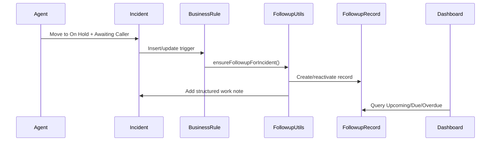

# Architecture

Incident Follow-up Assistant is organized around a small set of ServiceNow platform components:

- Business Rules detect incident lifecycle changes.
- A Script Include centralizes follow-up logic.
- A scheduled job recalculates status buckets.
- Agent and manager UIs expose the work queues.
- Configuration records/properties control timing and behavior.

## Runtime Flow

## Components

### Script Include

`FollowupUtils.js` owns shared logic:

- identify whether an incident is awaiting caller response
- create or reactivate follow-up records
- calculate status buckets
- record attempts and outcomes
- write consistent work notes
- calculate ageing and repeat cycle count

### Business Rules

Business Rules keep platform behavior close to the Incident and Follow-up records:

- create a follow-up when an incident enters Awaiting Caller
- recalculate status when key fields change
- validate follow-up attempts before save
- process attempts into incident work notes

### Scheduled Job

The scheduled job recalculates follow-up status so records move from Upcoming to Due to Overdue even when no one edits the incident.

### Client UI

The UI layer is split into:

- Agent Command Center: queue and inline update experience for agents
- Team Overview: manager dashboard for due buckets, attempts, ageing, and repeat cycles

## Design Principles

- Keep private data out of public code and screenshots.
- Put business rules in reusable helpers where possible.
- Make the agent workflow fast enough for daily use.
- Let managers see risk without opening every incident.
- Prefer configurable properties over hard-coded operational thresholds.

